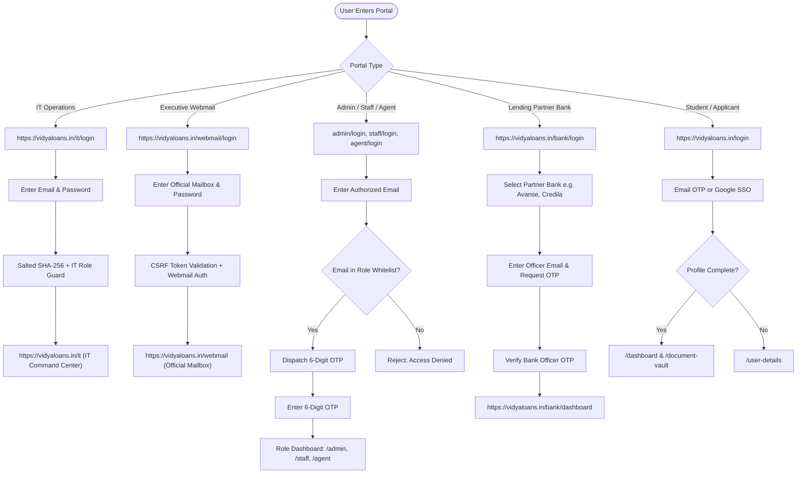

# VidyaLoans Enterprise Platform — Executive Dashboard & Authentication Manual
*Official Handover Reference for Higher Officials, Executive Leadership & System Administrators*

---

## Executive Summary

The **VidyaLoans Enterprise Platform** implements a role-based, zero-trust authentication and authorization architecture. Each internal division and external partner has a dedicated portal tailored to their operational responsibilities, guarded by secure authentication protocols:
1. **Password-Based Authentication**: Implemented for technical operations (IT Operations) and executive communications (Webmail), backed by salted SHA-256 hashing and CSRF tokens.
2. **One-Time Password (OTP) Authentication**: Implemented for administrative, staff, financial banking partners, agents, and student applicants via time-bound, 6-digit cryptographically generated tokens dispatched directly to verified email addresses.
3. **Admin Provisioning Hierarchy**: High-security accounts (IT, Staff, Bank Partners, Agents) are provisioned, monitored, and revoked exclusively by platform administrators.

---

## Master Dashboard Access Matrix (Production Domain)

The following table summarizes all operational dashboards, their official production URLs on **`https://vidyaloans.in/`**, primary authentication mechanisms, and target personnel:

| # | Dashboard / Portal | Official Production Portal URL | Primary Auth Method | Target Stakeholders / Roles |
|---|-------------------|--------------------------------|---------------------|-----------------------------|
| **1** | **Admin Command Center** | [https://vidyaloans.in/admin/login](https://vidyaloans.in/admin/login) | **6-Digit Email OTP** | Super Administrators, System Owners |
| **2** | **Executive Webmail** | [https://vidyaloans.in/webmail/login](https://vidyaloans.in/webmail/login) | **Email + Password** | Higher Officials, Executive Mailbox Accounts |
| **3** | **IT Operations Command** | [https://vidyaloans.in/it/login](https://vidyaloans.in/it/login) | **Email + Password** | IT Engineers, DevOps, System Administrators |
| **4** | **Staff & Operations Desk** | [https://vidyaloans.in/staff/login](https://vidyaloans.in/staff/login) | **6-Digit Email OTP** | Academic Coordinators, Verification Staff |
| **5** | **Lending Partner Banks** | [https://vidyaloans.in/bank/login](https://vidyaloans.in/bank/login) | **Bank Select + Email OTP** | Underwriters, Credit Officers, Bank Managers |
| **6** | **Agent Partner Network** | [https://vidyaloans.in/agent/login](https://vidyaloans.in/agent/login) | **6-Digit Email OTP** | Education Agents, Channel Partners, Consultancies |
| **7** | **Student / Applicant Vault**| [https://vidyaloans.in/login](https://vidyaloans.in/login) | **Email OTP / Google SSO** | Prospective Students, Co-applicants, Guarantors |
| **8** | **Credit & Risk Analyst** | [https://vidyaloans.in/analyst](https://vidyaloans.in/analyst) | **Staff / Analyst Auth** | Credit Assessors, Financial Risk Officers |
| **9** | **Marketing & Growth Desk** | [https://vidyaloans.in/marketing](https://vidyaloans.in/marketing) | **Staff / Marketing Auth** | Campaign Managers, Communications Teams |

---

## Authentication Flow Architecture



---

## Detailed Portal Login Protocols

### 1. Executive Webmail Portal
*Dedicated for higher officials, institutional correspondence, and official mailbox communications.*

* **Official Production URL:** [https://vidyaloans.in/webmail/login](https://vidyaloans.in/webmail/login)
* **Direct Webmail Interface:** [https://vidyaloans.in/webmail](https://vidyaloans.in/webmail)
* **Authentication Method:** **Email + Password**
* **Security Checks:** CSRF Token protection (`/api/csrf-token`), secure session bearer tokens stored in browser session.
* **How to Login:**
  1. Open [https://vidyaloans.in/webmail/login](https://vidyaloans.in/webmail/login).
  2. Input your official email address (e.g., `admin@vidyaloans.com`, `support@vidyaloans.com`, or designated executive mailbox).
  3. Enter your secure account password.
  4. Click **Access Official Mailbox**.
  5. The system authorizes the session and navigates directly to the Webmail client (`https://vidyaloans.in/webmail`), allowing reading, composing, and managing institutional communications.

> [!NOTE]
> Webmail access is restricted to verified operational email accounts. Unauthorized email addresses are blocked at the authentication API layer.

---

### 2. IT Operations Command Portal
*Dedicated for IT infrastructure engineers, DevOps, technical support coordinators, and blog CMS administrators.*

* **Official Production URL:** [https://vidyaloans.in/it/login](https://vidyaloans.in/it/login)
* **Direct IT Command Center:** [https://vidyaloans.in/it](https://vidyaloans.in/it)
* **Authentication Method:** **Email + Password**
* **Security Checks:** Password hash verification with SHA-256 + platform secret salt (`AUTH_SECRET`), role enforcement (`it`, `it_admin`, `admin`, `super_admin`), multi-month secure `itAccessToken` cookie.
* **How to Login:**
  1. Navigate to [https://vidyaloans.in/it/login](https://vidyaloans.in/it/login).
  2. Enter the registered IT Member email.
  3. Enter the administrator-assigned password.
  4. Click **Sign In to IT Command Center**.
  5. The system establishes the session and redirects to the IT dashboard (`https://vidyaloans.in/it`), providing access to live service status, ticket resolution queues, and technical blog builders.

#### How Administrators Add IT Personnel:
1. Log into the **Admin Portal** at [https://vidyaloans.in/admin](https://vidyaloans.in/admin).
2. Navigate to **Users & Roles** $\rightarrow$ **IT Operations** (URL: [https://vidyaloans.in/admin/it](https://vidyaloans.in/admin/it) or [https://vidyaloans.in/admin/users/it](https://vidyaloans.in/admin/users/it)).
3. Click the **+ Add IT Member** button.
4. Provide:
   - **First Name & Last Name**
   - **Official Email Address**
   - **Phone Number**
   - **Assigned Password** (minimum 6 characters)
5. Click **Create IT Member**. The system registers the account with a sequential identifier (e.g., `VL-IT-0001`), hashes the password securely, and optionally transmits an automated onboarding dispatch email with portal access instructions.

---

### 3. Administrator Command Center
*Dedicated for super administrators, company founders, and platform overseers.*

* **Official Production URL:** [https://vidyaloans.in/admin/login](https://vidyaloans.in/admin/login)
* **Direct Admin Dashboard:** [https://vidyaloans.in/admin](https://vidyaloans.in/admin)
* **Authentication Method:** **6-Digit Email OTP**
* **Security Checks:** Strict database role verification. Only accounts with role `admin` or `super_admin` can request an OTP. Non-admin email addresses receive an immediate `403 Access Denied: You do not have administrator access` response.
* **How to Login:**
  1. Open [https://vidyaloans.in/admin/login](https://vidyaloans.in/admin/login).
  2. Enter your authorized administrator email address.
  3. Click **Send Login Code**.
  4. Retrieve the 6-digit code delivered to your email inbox.
  5. Enter the 6 digits in the OTP input fields (supports automatic keyboard progression and paste).
  6. Click **Verify & Access Dashboard**.

> [!IMPORTANT]
> The admin OTP expires in 10 minutes. If the countdown timer elapses, click **Resend OTP** to generate a fresh security token.

---

### 4. Staff & Operations Desk
*Dedicated for student advisors, document verification officers, underwriting coordinators, and student query handlers.*

* **Official Production URL:** [https://vidyaloans.in/staff/login](https://vidyaloans.in/staff/login)
* **Direct Staff Dashboard:** [https://vidyaloans.in/staff/dashboard](https://vidyaloans.in/staff/dashboard)
* **Authentication Method:** **6-Digit Email OTP**
* **Security Checks:** Verifies the user's role against `staff`, `staff_admin`, and `support`. Prevents general student logins on internal staff routes.
* **How to Login:**
  1. Open [https://vidyaloans.in/staff/login](https://vidyaloans.in/staff/login).
  2. Enter your staff email address (e.g. `staff@vidyaloans.com`).
  3. Click **Send Login Code**.
  4. Enter the 6-digit verification code received by email.
  5. Click **Verify & Enter Staff Portal**.

#### Adding New Staff Members:
Admins can provision new staff accounts via **Admin Portal** $\rightarrow$ **Users** $\rightarrow$ **Staff Management** ([https://vidyaloans.in/admin/users/staff/create](https://vidyaloans.in/admin/users/staff/create)).

---

### 5. Institutional Lending Partner Portal (Banks & NBFCs)
*Dedicated for credit managers, underwriting officers, and loan sanction teams from partner banks (Avanse, Auxilo, HDFC Credila, IDFC FIRST, Poonawalla, etc.).*

* **Official Production URL:** [https://vidyaloans.in/bank/login](https://vidyaloans.in/bank/login)
* **Direct Bank Dashboard:** [https://vidyaloans.in/bank/dashboard](https://vidyaloans.in/bank/dashboard)
* **Authentication Method:** **Bank Institution Selection + 6-Digit Email OTP**
* **Security Checks:** Multi-tier authentication verifying that the entered email address belongs to authorized banking personnel assigned to the selected financial institution.
* **How to Login:**
  1. Navigate to [https://vidyaloans.in/bank/login](https://vidyaloans.in/bank/login).
  2. Click the **Select your bank…** dropdown menu and select your lending institution (e.g., *Avanse Financial Services*, *Auxilo*, *IDFC FIRST Bank*, *HDFC Credila*).
  3. Enter your institutional email address.
  4. Click **Send One-Time Password**.
  5. Enter the 6-digit OTP code received by email.
  6. Click **Verify & Sign In**.
  7. Upon successful login, the officer has access to assigned student dossiers, verified KYC documents streamed securely from AWS S3, and credit approval tools.

---

### 6. Channel Partner & Agent Network
*Dedicated for educational consultants, regional agents, and study-abroad advisors.*

* **Official Production URL:** [https://vidyaloans.in/agent/login](https://vidyaloans.in/agent/login)
* **Direct Agent Dashboard:** [https://vidyaloans.in/agent/dashboard](https://vidyaloans.in/agent/dashboard)
* **Authentication Method:** **6-Digit Email OTP**
* **Security Checks:** Validated against `agent` and `partner_agent` database records. Displays the partner's registered agency name upon OTP dispatch.
* **How to Login:**
  1. Open [https://vidyaloans.in/agent/login](https://vidyaloans.in/agent/login).
  2. Input the agency's registered email address.
  3. Click **Send Login Code**. The screen acknowledges the agency name (e.g., *"Welcome back, Krishna Agency"*).
  4. Enter the 6-digit verification code.
  5. Access the Agent Portal to track referred students and application milestones.

---

### 7. Student & Applicant Portal
*Dedicated for loan applicants, students studying abroad or domestically, and financial co-applicants.*

* **Official Production URL:** [https://vidyaloans.in/login](https://vidyaloans.in/login)
* **Direct Student Dashboard:** [https://vidyaloans.in/dashboard](https://vidyaloans.in/dashboard)
* **Direct Document Vault:** [https://vidyaloans.in/document-vault](https://vidyaloans.in/document-vault)
* **Authentication Method:** **6-Digit Email OTP** or **Google Sign-In (Firebase OAuth)**
* **How to Login:**
  1. Open [https://vidyaloans.in/login](https://vidyaloans.in/login).
  2. Enter email address and click **Send OTP**, or click **Continue with Google**.
  3. If logging in via OTP, enter the 6-digit code received.
  4. If first-time user, the system prompts for basic details (Full Name, Phone Number, Date of Birth).
  5. Once completed, the student accesses the main **Dashboard** and **Document Vault**.

---

### 8. Credit Analyst & Risk Assessment Portal
*Dedicated for financial statement analysis, credit scoring, and debt burden assessments.*

* **Official Production URL:** [https://vidyaloans.in/analyst](https://vidyaloans.in/analyst)
* **Authentication Method:** Inherits authenticated staff/admin session or dedicated analyst credential check.
* **Capabilities:** FOIR calculation, collateral valuation, income validation, and financial sanction recommendation workflows.

---

### 9. Marketing & Growth Operations Desk
*Dedicated for student acquisition campaigns, email automation broadcasts, and funnel metrics.*

* **Official Production URL:** [https://vidyaloans.in/marketing](https://vidyaloans.in/marketing)
* **Authentication Method:** Staff/Admin marketing clearance with dedicated access tokens.
* **Capabilities:** Campaign delivery analytics, lead tracking, email marketing automations, and engagement reporting.

---

## Security & Architectural Standards

### Password Storage & Cryptography
* Passwords for IT users and system accounts are never stored in plain text.
* Passwords undergo cryptographic hashing using **SHA-256** combined with a high-entropy server environment salt (`AUTH_SECRET`).
* When an administrator resets a user's password in the admin console, the new password is immediately re-hashed and salted before persisting to the database.

### Token Expiration & Session Lifecycle
* **Access Tokens (JWT):** Signed using HMAC-SHA256 (`JWT_SECRET`) with standard 24-hour expiration for administrative sessions and 30-day persistence for verified operational portals.
* **Refresh Tokens:** Long-lived tokens allowing seamless background session renewal without disrupting user workflow.
* **Cookie Security:** Cookies are written with `SameSite=Lax`, `path=/`, and appropriate `HttpOnly`/secure parameters in production environments.

### AWS S3 Storage Isolation
* Document viewing (Passport, Aadhaar, PAN, Marksheets) from the Bank Review desk (`/bank/applications?id=...&mode=review`) streams files directly from private **AWS S3** storage containers (`s3Service.getFileBuffer` and secure presigned URLs).
* Direct local disk file paths are bypassed to guarantee cloud-grade data isolation across all lending institutions.

---

## Quick Reference Summary for Officials

```
┌───────────────────────────────────────────────────────────────────────────────────────────────┐
│                           VIDYALOANS OFFICIAL PRODUCTION PORTAL URLS                          │
├──────────────────────────┬────────────────────────────────────────────┬───────────────────────┤
│ Portal Name              │ Official Production URL                    │ Login Method          │
├──────────────────────────┼────────────────────────────────────────────┼───────────────────────┤
│ Executive Webmail        │ https://vidyaloans.in/webmail/login        │ Official Mail + Pass  │
│ IT Operations Command    │ https://vidyaloans.in/it/login             │ IT Email + Password   │
│ Admin Command Center     │ https://vidyaloans.in/admin/login          │ Admin Email + OTP     │
│ Staff & Operations Desk  │ https://vidyaloans.in/staff/login          │ Staff Email + OTP     │
│ Partner Bank Desk        │ https://vidyaloans.in/bank/login           │ Select Bank + OTP     │
│ Agent Partner Network    │ https://vidyaloans.in/agent/login          │ Agent Email + OTP     │
│ Student / Applicant      │ https://vidyaloans.in/login                │ Email OTP / Google    │
│ Credit Analyst           │ https://vidyaloans.in/analyst              │ Role Clearance        │
│ Marketing Desk           │ https://vidyaloans.in/marketing            │ Role Clearance        │
└──────────────────────────┴────────────────────────────────────────────┴───────────────────────┘
```

*Report prepared and certified for VidyaLoans Higher Officials & Executive Management.*
